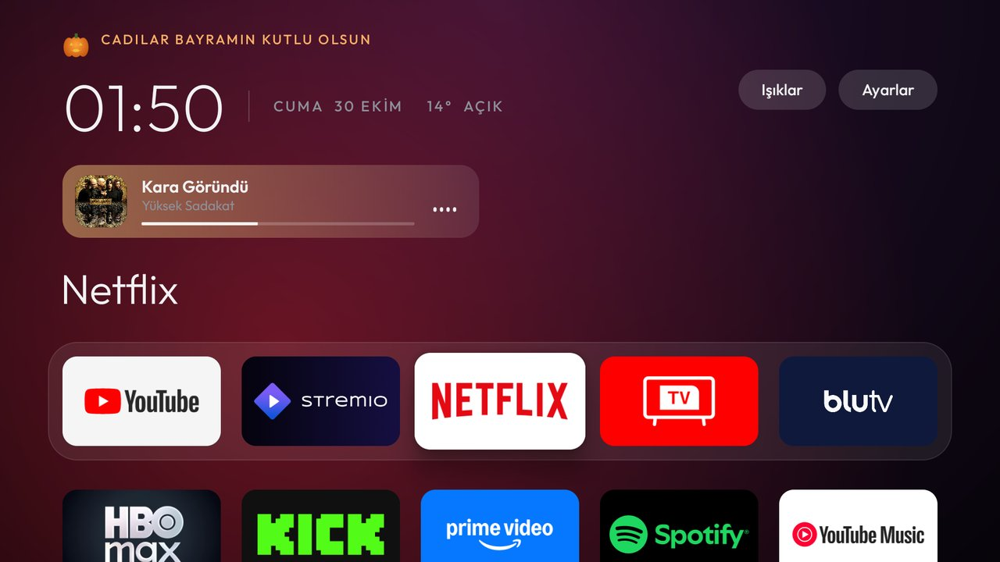
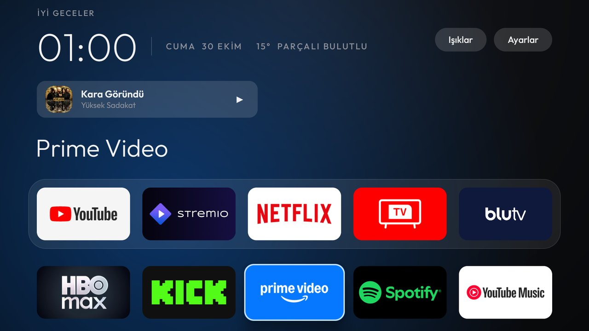
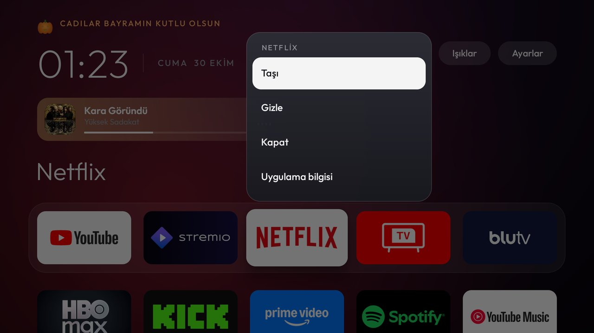
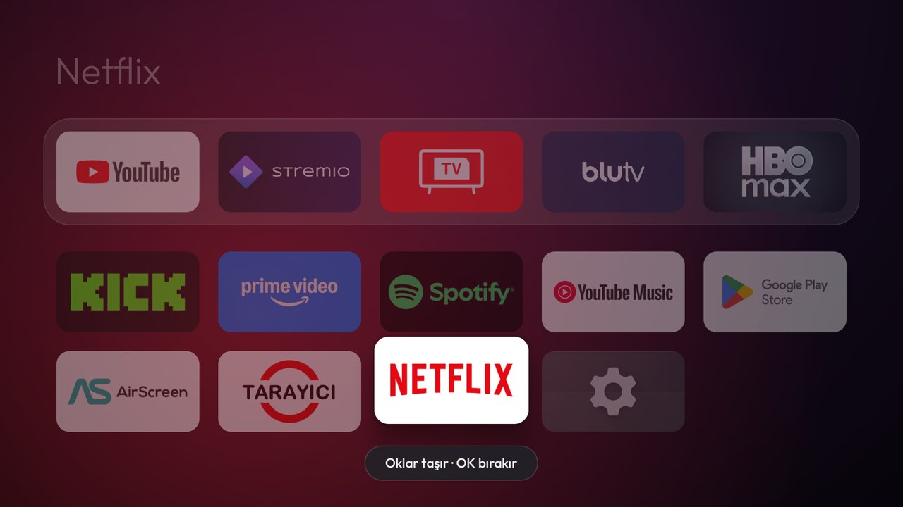
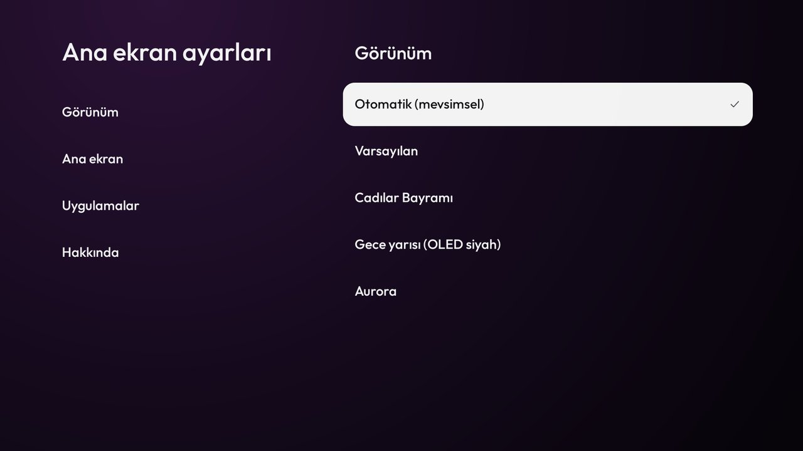
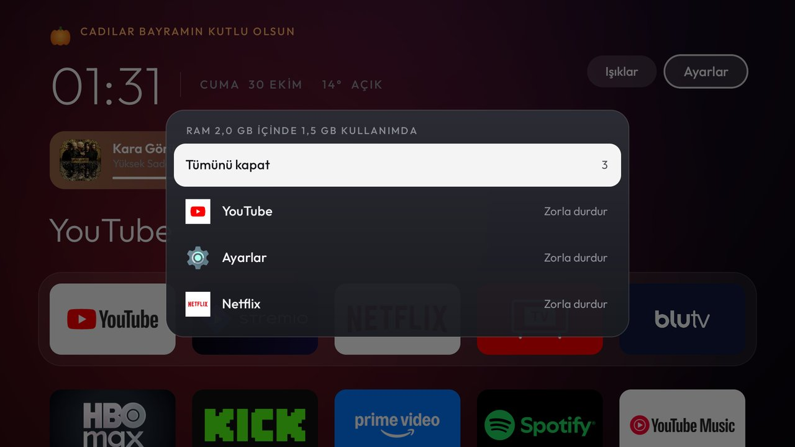
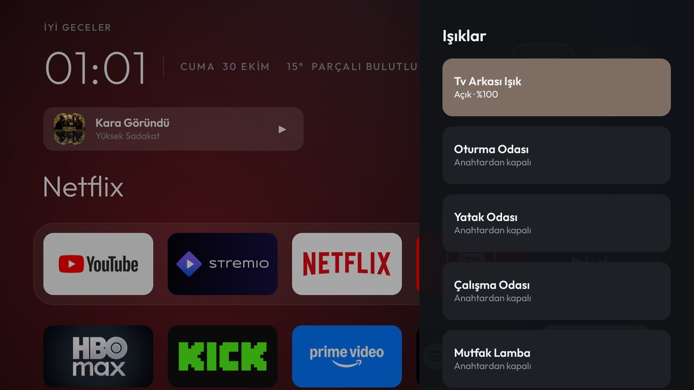
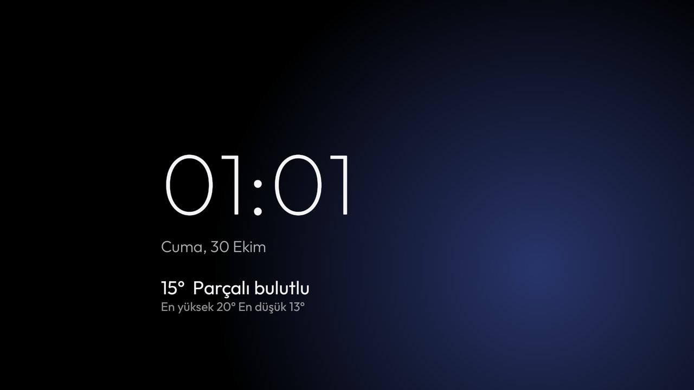

# android-tv-home

[English](README.md) · Türkçe

Android TV için sakin, tvOS tarzı bir ana ekran; Philips Hue ışıkların içinde.
Reklam yok, sponsorlu satır yok, hesap yok. Düz Java, kütüphane yok, yaklaşık 150 KB (56 KB'ı font), Gradle'sız derlenir.

<p align="center">
  
  
  
  
  
  
  
  
</p>

## Ne yapar

- **tvOS gibi bir ana ekran.** İnce bir saatin üstünde selamlama, yanında küçük ve aralıklı büyük harflerle tarih
  ve hava durumu. Odaktaki uygulamanın adı uygulamaların üstünde büyük yazılır ve arkadaki oda o uygulamanın
  rengini alır: Netflix'te kırmızı, Prime Video'da mavi. İlk beş uygulama bir dock bandında, gerisi altında
  ızgarada. Odak yaylanarak büyür ve oturur, geldiğin yöne hafifçe eğilir ve banner'ın üstünden bir parıltı geçer;
  ana ekran ilk açıldığında kartlar sırayla yerine yükselir. Her yazı [Outfit](https://fonts.google.com/specimen/Outfit) ile.
  Sayfa odakla birlikte süzülür; ızgara yukarı gelirken saat ve başlık solar.
- **Temalar.** Otomatik takvimi izler: Cadılar Bayramı haftasında (24 Ekim – 1 Kasım) ana ekran mora döner, turuncu
  bir ışık, selamlamanın yanında titreyen bir balkabağı feneri ve günde bir kez ana ekranın üstünden uçan bir yarasa
  sürüsü gelir. Ya da Ayarlar'dan Varsayılan, Cadılar Bayramı, Gece yarısı (OLED için saf siyah, ışıksız) veya
  Aurora seç.
- **Senin sıran.** Bir uygulamada OK'e basılı tut (ya da Menü'ye bas): kartından cam bir menü iner; **Taşı**,
  **Gizle**, **Kapat**, **Uygulama bilgisi** ve **Kaldır** (senin yüklediğin uygulamalar). Taşı kartı kaldırır ve
  diğerlerini karartır; oklar kartı ızgarada gezdirirken sayfa yerinde durur, OK bırakır.
- **Açık uygulamalar.** Ayarlar → Açık uygulamalar son kullandıklarını listeler, üstte kullanılan bellek. **Tümünü
  kapat** çalanı durdurur ve Android'den uygulamaları kapatmasını ister; bir uygulamanın satırı kendi bilgi
  sayfasını açar, orada **Zorla durdur** tek tuştur. (Bu TCL de dahil bazı TV'ler sıradan bir uygulamanın başka bir
  uygulamayı kapatma isteğini yok sayar; ölçüldü, bu yüzden kesin yol sistemin kendi Zorla durdur'u.)
- **Ana ekran ayarları.** İki bölme: tema, uygulama renginde ışık, selamlama, hareketi azalt, gizli uygulamalar
  (OK birini geri gösterir) ve uygulama sırasını sıfırlama.
- **Şimdi çalıyor.** Bir şey çalarken (Spotify, YouTube, Stremio...) üstte kapağı ve başlığı olan bir kart çıkar;
  kapağın renginde, çalarken hareket eden çubuklar ve parça ilerledikçe dolan bir çizgiyle. OK duraklatır ya da
  oynatır, Sol ve Sağ atlar. Arka planda unutulmuş bir video bir tuş uzağında.
- **Hue ışıklar bir tuş uzağında.** Ayarlar'ın yanındaki Işıklar pill'i ışık panelini sağdan kaydırır: her lamba
  için lambanın gerçek renginde bir kart; duvar anahtarından kapalı lambalar bunu söyler. OK lambayı açar ya da
  kapatır; OK'e basılı tutmak parlaklık, renkler, Hue uygulamasının sahnelerinden 103 palet, kendi Hue sahnelerin
  ve köprünün efektleri (mum, şömine, opal...) için. Hue uygulamasından ya da duvar anahtarından yapılan
  değişiklikler hemen görünür (köprünün olay akışı).
- **Film modu.** TV'nin arkasındaki şerit için aç. Bir uygulamayı açmak hiçbir şeyi değiştirmez. Bir video birkaç
  saniye oynadıktan sonra şerit oynayanın renklerini (kapak görseli) alır, daha canlı hale getirir ve yumuşak
  geçişlerle şerit boyunca yavaşça kaydırır. Önizlemelerde gezinmek ve kapaksız videolar rengine dokunmaz,
  odadaki diğer lambalara da. Duraklatınca ya da beklemede kayma durur. Ana ekrana dönünce şerit, gradyanı ya da
  efektiyle birlikte eski haline döner.
- **Işıklar her yerden.** Kumandada tek bir tuş (TCL kumandalarında 123 tuşu) aynı paneli, ne oynuyorsa onun
  üstüne sağdan kaydırır. Uygulama Ayarlar'dan zorla durdurulursa Android bu tuşu kapatır; geri getirmek için
  `./home.sh panel-key` komutunu tekrar çalıştır.
- **Ekran koruyucu.** Yavaşça kayan bir ışığın üstünde büyük ince bir saat, tarih ve hava durumu; yazı her dakika
  yer değiştirir, böylece ekranda iz kalmaz.
- Hue Bridge'i kendisi bulur (mDNS); eşleştirme köprünün düğmesine bir kez basmaktır.

## Işıklar neden görüntüyü değil kapağı takip ediyor

İlk plan gerçek ekran senkronuydu. Bunun yapıldığı TCL gibi TV'lerde bu çalışamaz: video, Android'in ekran
yakalamasının hiç görmediği bir donanım katmanında oynar (`adb shell screencap` dahil her yakalama, videonun
olduğu yerde siyahtır) ve TV üreticisinin kendi yakalama servisi yalnızca onun platform anahtarıyla imzalanmış
uygulamalara cevap verir. Bu yüzden film modu Android'in paylaştığını kullanır: şimdi çalanın kapağı. Sahne sahne
canlı ışık için görüntüyü HDMI ile bir Hue Sync Box'tan geçir.

## Neyi gönderir, neyi görebilir

Bize hiçbir şey gelmez; bizim bir sunucumuz yok. Uygulama şunlarla konuşur:

| Nereye | Ne | Ne zaman |
| --- | --- | --- |
| Senin Hue Bridge'in (senin ağın) | Işık komutları ve köprünün olay akışı | Ana ekran ya da ışık paneli açıkken; film modunda video oynarken |
| `api.open-meteo.com`, `geocoding-api.open-meteo.com` | Yaklaşık koordinatlar (iki ondalık, yaklaşık 1 km) ya da saat diliminin şehri | Hava durumu, en fazla 30 dakikada bir |
| `ip-api.com` (düz HTTP) | Ağının genel IP adresi, kaba bir konum bulmak için | Bir kez, yalnızca TV'nin saat diliminde şehir yoksa (örn. `GMT+03:00`) |
| Video uygulamalarının kapak görseli adresleri | Normal bir görsel indirme | Bir video uygulaması kapağını bağlantı olarak verdiğinde |

Kurulum komutları iki izin verir, ikisini de Android ayarlarından kapatabilirsin:

- **Bildirim erişimi** (`./home.sh install`), *Film modu renkleri* için: film modu ve Şimdi çalıyor için oynayan
  uygulamanın medya oturumunu (başlık ve kapak) okur. Hiçbir bildirimi okumaz.
- **Erişilebilirlik** (`./home.sh panel-key`), *Işık tuşu* için: tek bir tuşun ışık panelini diğer uygulamaların
  üstünde açabilmesi için tuş basışlarını alır. Ekranda hiçbir şey okumaz.
- **Kullanım erişimi** (`./home.sh install`), *Açık uygulamalar* için: hangi uygulamaların ne zaman kullanıldığı.
  TV'de kalır.

`./home.sh home` bu uygulamanın saatini ekran koruyucu da yapar.

## Kurulum

`adb`, JDK 17 ve Android SDK (build-tools 36.0.0, platform android-34) olan bir Mac ya da Linux makine gerekir.
TV'de ağ hata ayıklamasını aç (Ayarlar → Cihaz Tercihleri → Hakkında: *Yapı*'ya 7 kez bas, sonra Geliştirici
seçenekleri).

```bash
adb connect 192.168.1.80:5555     # TV'nin adresi; TV'deki onayı kabul et
./home.sh install                 # derle, yükle, Şimdi çalıyor / film modunun medya oturumunu okumasına izin ver
./home.sh home                    # ana ekran ve ekran koruyucu yap
./home.sh panel-key               # isteğe bağlı: tek bir kumanda tuşu ışık panelini her yerden açar
./home.sh restore                 # ana ekranı TV'nin kendi başlatıcısına geri ver
```

`./home.sh home` önce Android'den ana ekran için bu uygulamayı kullanmasını ister. Birçok TV yine de kendi
başlatıcısını dayatır; ana ekran değişmezse stok başlatıcıyı `pm disable-user` ile kapatır (verisiyle birlikte
yüklü kalır) ve `restore` için `.local/` içinde hatırlar.

## Yavaş TV'lerde

Bunun yapıldığı TCL'de ölçüldü (Realtek RTD288O, ekran 50 Hz, yani kare başına 20 ms): hareket eden 1080p bir ana
ekranın her karesi orada yaklaşık 30 ms sürüyor; ışıkla ya da ışıksız, gölgeli ya da gölgesiz, eğilmeli ya da
eğilmesiz; bu yeniden tasarımdan önceki sürüm de aynı ölçüldü. Böyle bir TV'de animasyonlar, ana ekran ne çizerse
çizsin saniyede 25-30 karede akar. Ayarlar → Ana ekran → Hareketi azalt hareketleri kısaltır, eğilmeyi ve yaylanmayı
kaldırır; orada ortanca kareyi 29 ms'den 20 ms'ye indirdi.

## Derleme ve test

```bash
./home.sh build    # dist/android-tv-home.apk, .signing/ içindeki yerel bir anahtarla imzalanır
./home.sh test     # saf Java parçaları (uygulama sırası, renkler, paletler, hava durumu) bilgisayarının JVM'inde
```

## Teşekkürler

`res/raw/hue_palettes.txt` içindeki palet renkleri
[labmonkey'in Hue uygulaması sahneleri dökümünden](https://gist.github.com/labmonkey/a641f6b339ed9a71bdced64b9af91ee8).
Hue API ayrıntıları [OpenHue API](https://github.com/openhue/openhue-api) şartnamesini izler. Hava durumu
[Open-Meteo](https://open-meteo.com)'dan. Fikirler [Luma](https://github.com/0xProbabillity/luma-tv),
[ScreenBloom](https://github.com/kershner/screenbloom) ve [CleanYourTV](https://github.com/Gathin23/cleanyourtv)'den
(dock, büyük başlık, uygulamanın renginde ışık, kararan taşıma modu ve inen menü) ile
[tvOS Launcher](https://github.com/techgenius1/tvOS-Launcher)'dan (iki bölmeli ayarlar ve açık uygulamalar listesi). Font [Outfit](https://github.com/Outfitio/Outfit-Fonts),
SIL Open Font License ile; bkz. [FONT-LICENSE.txt](FONT-LICENSE.txt).

Kardeş proje: [android-tv-debloat](https://github.com/caferyukseloglu/android-tv-debloat) TV'nin reklamlarını ve
arka plandaki kalabalığı kapatır.

## Lisans

MIT
